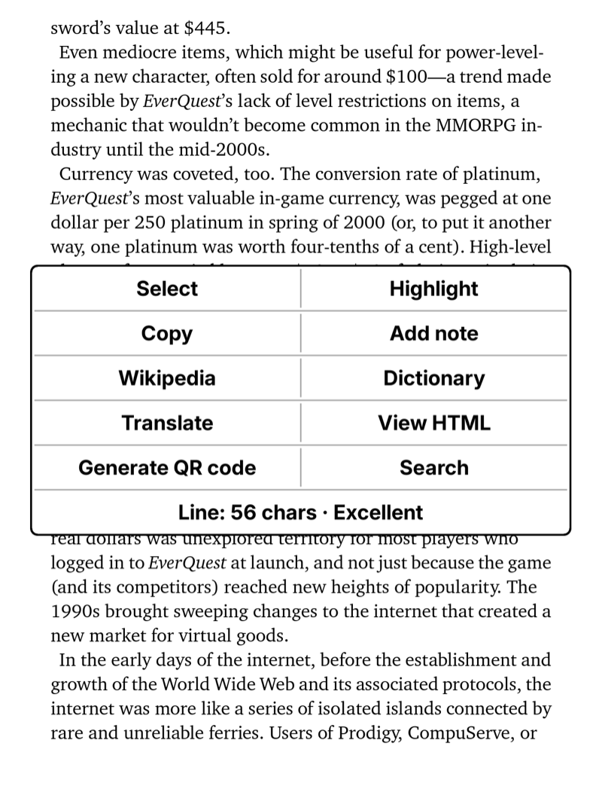
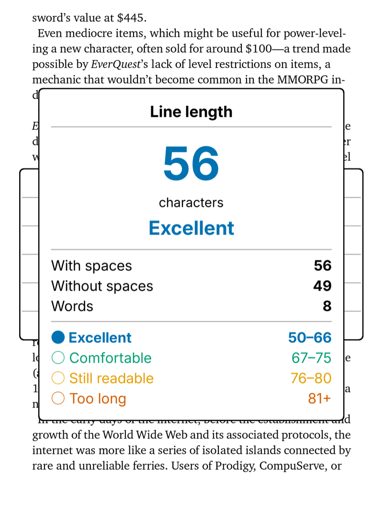
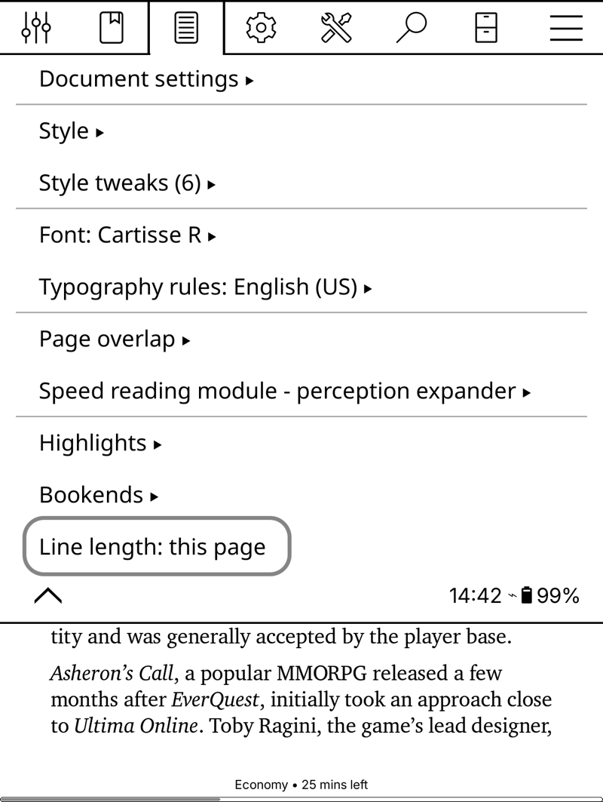

# Line Length: a line-length checker for KOReader

*Formerly called Word count.*

Two ways to check how long the lines of a book are, and whether that is a good length for reading:

- **A line you select.** Select one line of text and the highlight dialog tells you how many characters it
  holds and how that reads. Tap the button for the details.
- **The whole page.** *Line length: this page* in the Typeset menu lists the longest lines on the page you
  are looking at, rated by the longest. No selection, and no highlight dialog needed.

|  |  |
|:---:|:---:|
| *The selection dialog after selecting a line. The extra button at the bottom shows how many characters the line has (56 here) and where that falls: Excellent.* | *Tap the button for the card: the count with and without spaces, the word count, and the four ranges with yours marked. It is drawn in colour on a colour screen.* |
|  |  |
| *The whole-page mode starts from the Typeset menu: the last item, Line length: this page.* | *The card for the whole page: the longest line has 59 characters (Excellent). Under it are the three longest lines, each with its place on the page (L11 is the eleventh line) and its length, then the four ranges. The X in the corner closes it.* |

Screenshots from a Kobo Libra Colour running KOReader v2026.07.2.

## Requirements

- Any device KOReader runs on. Colour needs a colour screen with KOReader's colour rendering on; on
  a black-and-white screen the card is in black and white. Only a Kobo Libra Colour has been tried.

## Why this exists

I wanted the lines of a book to land in the recommended range of characters per line, and the way to
get there is to change the font size and the margins until they do. KOReader has no way to show that
number. What I did instead was retype a line into a word counter on my computer or phone, read off
the characters including spaces, go back to the e-reader, change a setting, and start again.

This plugin does the counting where the text is, so the only thing left to do is to play with the font
size and margins until the line reads **Excellent**.

## Using it

### A line you select

1. Open a book. Long-press the first word of a line and drag to the end of the line.
2. The selection dialog has one extra button, last and full width: `Line: 58 chars · Excellent`.
3. Tap it for a card with the character count, the verdict, the counts with and without spaces, the
   word count, and the four ranges with yours marked.
4. Change the font size or the margins, select another line, and check again.

The number is for whatever you select, so select one line. In justified text the lines differ by a few
characters, so check two or three.

### The whole page

1. Open the Typeset menu (the tab with a page of text on it) and tap **Line length: this page**.
2. The card shows the **longest line** on the page, its verdict and the four ranges. Under the bold heading
   *Longest lines on this page:* are the three longest lines, each as `L5: start of the text … 54`: `L5` is
   that line's place on the page, counted from the top (the fifth line), then the start of its text, then
   its length in characters.
3. Tap the X in the top right corner, or anywhere, to close it.

The action is also in KOReader's gesture list as *Line length: this page*, so it can go on a tap zone, a
corner or a profile.

Why the longest lines and not an average: the last line of every paragraph is short, so an average
over the page would say less about the text than about how many paragraphs it has. The longest lines are
not touched by that, and a line that is too long is the one that tires the eye. It is also the strictest
reading: justified lines vary by a few characters, so the longest is a little above the typical line.
The verdict is the longest line's.

It reads the lines of the page that is on screen, so it works only in books that reflow (EPUB, FB2 and
the like), not in a PDF or a comic.

Thanks to the reddit user [Zanzel_Melancthones](https://www.reddit.com/user/Zanzel_Melancthones) for the suggestion to implement it this way.

## What the ranges are

A "character" is a character of the line including spaces and punctuation. The ranges come from print
typography and from accessibility guidance on the length of a line (the "measure"):

| Characters | Verdict | Basis |
|---|---|---|
| under 50 | Short | Below the 50 where Baymard and Ruder start. Bringhurst accepts lines down to 45 in a single column, so 45–49 shows as Short |
| 50–66 | Excellent | From the 50–60 that Ruder found optimal (as quoted by Baymard) up to the 66 that Bringhurst calls ideal |
| 67–75 | Comfortable | The rest of the satisfactory range: inside Bringhurst's 45 to 75 and Baymard's 50 to 75, but past the ideal |
| 76–80 | Still readable | Past 75, within the 80-character limit of WCAG 1.4.8 |
| 81 and more | Too long | Over the 80-character limit of WCAG 1.4.8 |

These are guidelines, not measurements of your reading. Bringhurst words his figures as "widely
regarded", and the sources do not agree to the character. The bands are a way to see at a glance where a
line sits between them.

Not covered:

- **Two columns.** Bringhurst gives 40 to 50 characters as better for multi-column work. The ranges
  above are for a single column, so a good two-column line of 40 to 49 characters shows as "Short".
- **Chinese, Japanese and Korean.** WCAG puts the limit at 40 glyphs for these scripts, not 80.
- **Landscape.** The ranges apply unchanged. A wider page holds more characters per line at the same
  font size, so raise the font size or the margins to stay in range.

## What is counted

- Characters are Unicode characters, so `é` is one, however it is encoded.
- The selection is cleaned the way KOReader's Copy cleans it: the ends are trimmed and runs of spaces
  become one space.
- Invisible characters (soft hyphen, zero-width space and joiners, direction marks, byte order mark)
  are not counted.
- A word is a run of characters between spaces that has at least one character that is not
  punctuation, so a lone dash or `...` is not a word.
- **Hyphenated words.** Selecting text snaps to whole words, so if a line ends in a hyphenated word
  (`moun-` / `tain`) the button counts the whole word on that line. The whole-page check does not: it
  asks KOReader where each letter of the first and last word of every line is drawn and counts only
  those on the line. On a test book the plain count made the longest line read up to 10 characters too
  long. The hyphen that KOReader draws at the break is not counted.

## Colour

On a colour screen, with KOReader's colour rendering on, the number, the verdict and the four range rows
are drawn in the Okabe–Ito palette, which is chosen to stay distinguishable with common forms of colour
blindness:

| Verdict | Colour |
|---|---|
| Excellent | `#0072B2` |
| Comfortable | `#009E73` |
| Still readable | `#E69F00` |
| Too long | `#D55E00` |

On a black-and-white screen, with colour rendering off, and for "Short", everything is in the normal
text colour. The button in the dialog is always plain, like the others.

## Install

1. Download `linelength.koplugin.zip` from the [latest release](../../releases/latest) and extract it.
2. Copy the `linelength.koplugin` folder into KOReader's plugins folder and restart KOReader. On a Kobo
   that is `.adds/koreader/plugins/`.
3. Open a book. Select some text and the button is the last one in the dialog, or open the Typeset menu
   and tap **Line length: this page**.

### Upgrading from Word count

This plugin used to be called Word count, in a folder named `wordcount.koplugin` (versions up to 0.6.0).
**Delete that folder before you copy `linelength.koplugin`.** If both stay, both load and the button and
the menu item show up twice. The plugin keeps no settings, so nothing is lost. A gesture you set to
*Line length: this page* keeps working: the action's internal id is still `wordcount_page` on purpose,
because KOReader stores that id in the gesture settings.

## Tested on

A Kobo Libra Colour (firmware 4.45) with KOReader v2026.07.2. The button, the card, the whole-page mode
and the colours show on its screen.

## How it works

- `main.lua` registers the button in slot `13_line_length`. KOReader sorts the buttons by that key, so
  the button comes after the built-in ones. It builds the label each time the dialog opens. It also adds
  the Typeset menu item and the gesture action, whose id is still `wordcount_page` (see Upgrading).
- `linelength/pagelines.lua` reads the lines of the page on screen from KOReader's document engine
  (`getTextFromPositions` for the lines, `getScreenPositionFromXPointer` to find which letters of a
  hyphenated word are on which line, `getTextFromXPointers` to read the text that is left) and picks the
  longest. It does not use KOReader itself: the engine is passed in, so it is tested on a desktop with a
  fake one.
- `linelength/counter.lua` counts and `linelength/rating.lua` holds the ranges. Neither uses KOReader, so both
  are tested on a desktop.
- `linelength/report.lua` shapes the numbers for the card, and `linelength/details.lua` draws it from KOReader's
  own widgets. If building the card fails, the same information is shown as plain text.
- `linelength/colortext.lua` is a `TextWidget` that keeps the colour. KOReader's `TextWidget` blits glyphs
  through `getColor8A()`, which keeps only the brightness of a colour, so any text colour comes out grey.
  This widget draws the same glyphs with `colorblitFromRGB32` when the colour is not a grey, and
  defers to `TextWidget` otherwise.

## Tests

```
python3 -m venv .venv && .venv/bin/pip install lupa
.venv/bin/python tests/run.py
```

There is no `lua` binary needed: the tests run in [lupa](https://pypi.org/project/lupa/). They cover
the counting (checked against Python's own `len()` on 3000 random strings), every edge of every range,
the card's data, the page reading against a fake document engine (hyphenated words, page edges, an
engine that fails), and the wiring in `main.lua` with KOReader stubbed out. The wiring test models
source, not the device.

`tests/engine.lua` runs the page reading against KOReader's real text engine (crengine) on the books
made by `tests/fixtures/make_epub.py`: for every page, justified and left-aligned, at three font sizes,
the line lengths must add up exactly to the text of that page, and every line's number (the `L5`) must be
the row the engine itself lists at that place on the page. It needs the desktop build of KOReader;
the header of the file says how to run it.

`tests/plugin.lua` runs the real `main.lua`, the real engine and the real card together: it checks that the
numbers on the card match the page's own lines, that the X is in the top right corner and its action closes
the card, and that the action runs through KOReader's own gesture dispatcher.

`tests/render.lua` draws the button dialog and the cards with a desktop build of KOReader and saves
PNGs at the size of a Libra Colour. It shows what the code draws into KOReader's buffer, not what a
screen displays. The header of the file says how to run it.

## License

AGPL-3.0-or-later, the same as KOReader. See [LICENSE](LICENSE).

## Sources

- Robert Bringhurst, *The Elements of Typographic Style*, as quoted in [2.1.2 Choose a comfortable
  measure](http://webtypography.net/2.1.2): "Anything from 45 to 75 characters is widely regarded as a
  satisfactory length of line for a single-column page set in a serifed text face in a text size. The
  66-character line (counting both letters and spaces) is widely regarded as ideal. For multiple column
  work, a better average is 40 to 50 characters."
- Baymard Institute, [Readability: The Optimal Line Length](https://baymard.com/research-articles/line-length-readability):
  "optimal line length for body text is 50–60 characters per line, including spaces" (Emil Ruder), and
  "up to 75 characters is acceptable".
- W3C, [Understanding Success Criterion 1.4.8: Visual Presentation](https://www.w3.org/WAI/WCAG22/Understanding/visual-presentation.html):
  "Width is no more than 80 characters or glyphs (40 if CJK)."
